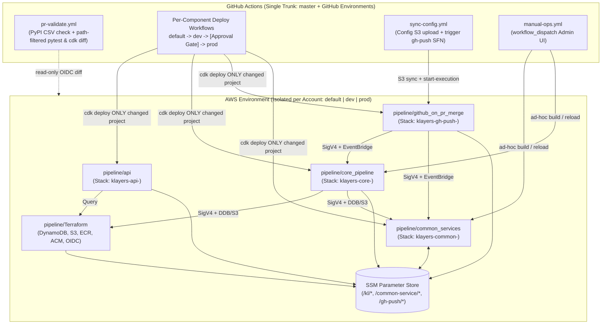
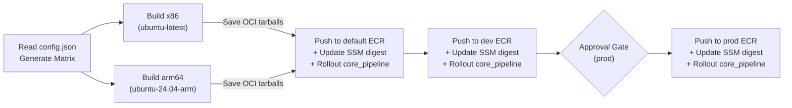
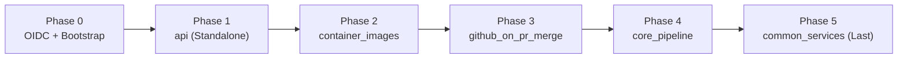

# Klayers Migration Plan: Modular Python CDK Mini-Apps & GitHub Environments

## 1. Executive Summary & Locked Decisions

Klayers is intentionally structured as **separate, loosely coupled components** that communicate via AWS SSM Parameter Store and EventBridge. This plan migrates Klayers off the deprecated Serverless Framework (v2/v3 + `@bref.sh/serverless` fork) while preserving strict blast-radius isolation between services and moving all deployments to **GitHub Actions + GitHub Environments**.

### Locked Architectural Decisions
1. **Per-Service Python CDK Mini-Apps**: Each Serverless Framework service is replaced **1-for-1** with its own self-contained AWS CDK (Python) mini-app (`infra.py` + `cdk.json` + `pyproject.toml` managed via `uv`). Services remain decoupled strictly via **SSM Parameter Store** (zero CloudFormation cross-stack `Export`/`ImportValue` locks), so a small change in one folder only deploys that single stack.
2. **Rename `pipeline/Serverless` -> `pipeline/core_pipeline`**: Clearer naming once Serverless Framework is removed.
3. **Keep `pipeline/Terraform` on Terraform Cloud**: Stateful foundational resources (DynamoDB `db-ver2`, S3 buckets, ECR repos, ACM certificate, and GitHub OIDC) remain in Terraform as-is, requiring only a small IAM policy addition so GitHub OIDC roles can assume CDK bootstrap roles.
4. **GitHub Environments Promotion (`default` -> `dev` -> `prod`)**: Retire the 6 legacy deployment branches (`klayers-default`, `klayers-dev`, `container_builds-*`) in favor of a single trunk (`master`) promoting sequentially through **GitHub Environments** (`default` -> `dev` -> reviewer gate -> `prod`), plus `workflow_dispatch` to test feature branches in `default`/`dev`.

---

## 2. Current State & Issues Addressed by This Migration

### 2.1 AWS Account & Environment Mapping

| GitHub Environment | Legacy Stage Name (`STAGE`) | AWS Account ID | Primary Region | Config Directory | Public API Domain |
| :--- | :--- | :--- | :--- | :--- | :--- |
| **`default`** | `Klayers-defaultp38` | `367660174341` | `ap-southeast-1` | `pipeline/config/test_config` | `api-default.klayers.cloud` |
| **`dev`** | `Klayers-devp38` | `908645878701` | `us-west-2` | `pipeline/config/test_config` | `api-dev.klayers.cloud` |
| **`prod`** | `Klayers-prodp38` | `770693421928` | `us-east-2` | `pipeline/config` | `api.klayers.cloud` |

*(Note: We retain the `STAGE` string values `Klayers-defaultp38`, `Klayers-devp38`, and `Klayers-prodp38` internally so all existing SSM parameter paths `/kl/<stage>/*` and DynamoDB table names `kl.<stage>.db-ver2` continue working with zero data migration.)*

### 2.2 Component Inventory: Before vs. After

| Component Directory | Current Tooling | Target Tooling | AWS Resources Owned |
| :--- | :--- | :--- | :--- |
| `pipeline/Terraform` | Terraform Cloud | **Keep as-is** *(+ CDK OIDC policy)* | DynamoDB (`db-ver2`), S3 buckets, ECR repos, ACM cert (`us-east-1`), GitHub OIDC roles, base SSM params |
| `pipeline/common_services` | Serverless v3 (`python3.9`) | **CDK Python Mini-App (`python3.13`)** | IAM-authed HTTP API + 4 config Lambdas + `/common-service/<stage>/*` SSM params |
| `pipeline/github_on_pr_merge` | Serverless v3 (`python3.9`) | **CDK Python Mini-App (`python3.13`)** | `gh-push` Step Function + 6 Lambdas + `/gh-push/<stage>/PipelineArn` SSM param |
| `pipeline/container_images` | 6x duplicate Dockerfiles + QEMU GHA | **1x Parameterized `Dockerfile` + Native ARM64 GHA** | Builds `x86` & `arm64` builder images -> pushes ECR -> updates `/kl/<stage>/build/*/digest` SSM |
| `pipeline/api` | Serverless v2/v3 (`python3.8`) | **CDK Python Mini-App (`python3.13` `arm64`)** | CloudFront (`api.klayers.cloud`) + HTTP API + 4 query Lambdas + CF ID SSM param |
| `pipeline/core_pipeline` *(was `Serverless`)* | Serverless v2/v3 + Bref (`python3.8`/`3.9`) | **CDK Python Mini-App (`python3.13` + ECR)** | Build Step Function, dynamic `Build*` container Lambdas, monthly cron, DDB Stream TTL deleter, Slack Lambdas |

### 2.3 Technical Debt Resolved Along the Way

1. **EOL Lambda Runtimes (`python3.8` & `python3.9` -> `python3.13`)**: AWS blocks CloudFormation updates on Python 3.8/3.9. All zip-based control-plane Lambdas are upgraded to `python3.13` (and `datetime.utcnow()` calls updated to `datetime.now(timezone.utc)`).
2. **Self-Contained Packaging (No Circular Layer Dependencies)**: Control-plane functions currently reference legacy external/self-hosted layers (`113088814899:layer:Klayers-python37-packaging:1`, `Klayers-p38-slackclient:6`, Powertools v1). Each CDK mini-app bundles its own `requirements.txt` dependencies cleanly at deploy time alongside AWS's official regional `AWSLambdaPowertoolsPythonV3` layer.
3. **Data-Driven Python Versions**: `pipeline/core_pipeline/infra.py` reads `../config/config.json` in a standard Python loop to generate all `Build<PyVer>` container Lambdas and Step Function `Choice` branches automatically—eliminating manual YAML copy-pasting when Python 3.15+ arrives.
4. **Bug Fixes**:
   - Fix `slackTokenParameter` double-brace typo in `pipeline/Serverless/serverless.yml` (`/${self:service}}/...` -> `/kl/${stage}/slack_token`) and replace deprecated `import slack` (`slackclient` v2) with `slack_sdk` / `urllib.request`.
   - Upgrade `github_on_pr_merge` Step Function `Map` state from legacy `Iterator` to `ItemProcessor`.
   - Remove the broken `.github/workflows/issue_commented.yml` stub and retire the 6 multi-branch workflow triggers.

---

## 3. Target Repository Layout & Mini-App Design



### Directory Structure

```text
Klayers/
├── .github/workflows/
│   ├── _reusable-cdk-deploy.yml     # Shared OIDC + uv + CDK deploy promotion (default -> dev -> prod)
│   ├── pr-validate.yml              # Path-filtered: PyPI CSV validator + ruff/pytest + cdk diff PR comment
│   ├── deploy-common-services.yml   # Trigger: pipeline/common_services/**  | workflow_dispatch
│   ├── deploy-pr-merge.yml          # Trigger: pipeline/github_on_pr_merge/** | workflow_dispatch
│   ├── deploy-containers.yml        # Trigger: pipeline/container_images/** | workflow_dispatch
│   ├── deploy-core-pipeline.yml     # Trigger: pipeline/core_pipeline/**    | workflow_dispatch
│   ├── deploy-api.yml               # Trigger: pipeline/api/**              | workflow_dispatch
│   ├── sync-config.yml              # Trigger: pipeline/config/**           | workflow_dispatch
│   └── manual-ops.yml               # workflow_dispatch UI: rebuild single package / force-deploy / reload config
└── pipeline/
    ├── config/                      # config.json, regions.csv, packages_*.csv, test_config/*
    ├── Terraform/                   # [Unchanged on Terraform Cloud] + OIDC policy for CDK bootstrap roles
    ├── container_images/            # Single parameterized Dockerfile + build.py
    ├── common_services/             # [CDK Mini-App 1] Stack: klayers-common-<stage>
    │   ├── cdk.json
    │   ├── infra.py
    │   ├── pyproject.toml           # CDK + test deps (uv)
    │   ├── requirements.txt         # Lambda runtime deps (bundled if any)
    │   ├── src/                     # get_config.py, get_config_s3.py, get_python_versions.py, load_config_from_s3.py, common/
    │   └── tests/
    ├── github_on_pr_merge/          # [CDK Mini-App 2] Stack: klayers-gh-push-<stage>
    │   ├── cdk.json
    │   ├── infra.py
    │   ├── pyproject.toml
    │   ├── requirements.txt         # requests, aws-requests-auth
    │   ├── src/                     # check_new_packages.py, check_python_versions.py, invoke_pipelines.py, ...
    │   └── tests/
    ├── api/                         # [CDK Mini-App 3] Stack: klayers-api-<stage>
    │   ├── cdk.json
    │   ├── infra.py
    │   ├── pyproject.toml
    │   ├── requirements.txt         # tabulate
    │   ├── src/                     # layers/*, builds/*, common/*
    │   └── tests/
    └── core_pipeline/               # [CDK Mini-App 4] Stack: klayers-core-<stage> (renamed from Serverless/)
        ├── cdk.json
        ├── infra.py                 # Dynamically loops over ../config/config.json for Build* Lambdas & SFN Choice
        ├── pyproject.toml
        ├── requirements.txt         # requests, packaging, aws-requests-auth, slack_sdk
        ├── src/                     # 01_invoke_pipelines/, 02_pipeline/, 04_stream_processor/, 05_slack_notification/, common/
        └── tests/
```

### Anatomy of Each CDK Mini-App

Every mini-app follows an identical, predictable convention:
- **`cdk.json`**: `"app": "uv run python infra.py"`
- **`pyproject.toml`**: Pins `aws-cdk-lib`, `constructs`, `pytest`, `moto`, `ruff` (locked via `uv.lock` for deterministic CI).
- **`requirements.txt`**: Pure-Python runtime dependencies bundled once per stack into an internal `lambda_.LayerVersion` (via local `uv pip install --target` during synth—no Docker-in-Docker required for zip Lambdas!), attached alongside the official regional `AWSLambdaPowertoolsPythonV3` layer.
- **`infra.py`**: Single ~100–200 line Python file reading `STAGE` from CDK context (`-c stage=Klayers-prodp38`), resolving SSM parameters (`ssm.StringParameter.value_for_string_parameter`), defining per-function IAM grants (`grant_read_data`, etc.), and defining HTTP APIs / Step Functions / EventBridge rules.

---

## 4. Container Build Architecture (`pipeline/container_images`)

To keep `container_images` fast and strictly decoupled from `core_pipeline` (so editing a Lambda handler or Step Function retry never triggers 6 slow Docker builds), we do **not** use CDK's `DockerImageCode.from_image_asset` (which builds sequentially on a single runner and forces ARM64 back onto QEMU emulation). Instead, `pipeline/container_images/` operates as its own standalone build-and-promote pipeline:

### 4.1 Single Parameterized `Dockerfile`

All 6 existing Dockerfiles under `pipeline/container_images/build_images/*` are identical except for line 1 (`FROM public.ecr.aws/lambda/python:<tag>`). We collapse all 6 subfolders and the CI `cp common/build.py` step into just **two files** inside `pipeline/container_images/`:
- `build.py`
- `Dockerfile`:
  ```dockerfile
  ARG BASE_IMAGE_TAG=3.14
  FROM public.ecr.aws/lambda/python:${BASE_IMAGE_TAG}

  RUN dnf update -y && dnf install -y python-devel && dnf clean all
  RUN pip install --no-cache-dir --upgrade pip boto3 aws-lambda-powertools

  COPY build.py ${LAMBDA_TASK_ROOT}/
  CMD ["build.main"]
  ```
Every entry in `pipeline/config/config.json` maps deterministically to `BASE_IMAGE_TAG` by stripping the leading `p` (`"p3.14"` -> `3.14`, `"p3.14-arm64"` -> `3.14-arm64`).

### 4.2 Dynamic Matrix + Native ARM64 Runners (No QEMU)

In `.github/workflows/deploy-containers.yml`:
- **Auto-generated matrix**: A lightweight `setup` job reads `python_versions` from `pipeline/config/config.json` via `jq` and outputs the build matrix dynamically—adding Python 3.15 later requires **zero workflow YAML edits**.
- **Native CPU runners in parallel**:
  - `x86` entries run on `ubuntu-latest` (`linux/amd64`).
  - `arm64` entries run on **`ubuntu-24.04-arm`** (GitHub's free native ARM64 runner for public repos), removing `docker/setup-qemu-action` and making `dnf update` / `pip install` ~5–10x faster.
- **Lambda OCI compatibility**: Retains `provenance: false` and `sbom: false` on `docker/build-push-action` so AWS Lambda accepts the single-platform image manifest.

### 4.3 Build Once -> Promote Exact Image Across Environments

Instead of running `dnf update` three separate times (which could pull slightly different OS packages between `dev` and `prod`), the workflow builds once and promotes the exact OCI artifact across environments:



### 4.4 Digest Rollout & Avoiding the CDK `from_ecr` Token Gotcha

- **The CDK Gotcha**: `aws_lambda.DockerImageCode.from_ecr(repo, tag_or_digest=...)` checks `tag_or_digest.startswith("sha256:")` **at synth time**. Passing a lazy CloudFormation SSM token (`value_for_string_parameter`) causes CDK to treat it as an image *tag* (`repo:<Token>`) rather than a *digest* (`repo@sha256:...`).
- **Solution**:
  1. `pipeline/core_pipeline/infra.py` fetches `/kl/<stage>/build/<py>/<arch>/repo` and `.../digest` **at synth time** (via `boto3` / `ssm.StringParameter.value_from_lookup` using the GitHub Environment's OIDC role), passing the real `"sha256:..."` string to CDK so `ImageUri: <repo>@sha256:...` synthesizes cleanly and appears clearly in `cdk diff`.
  2. At the end of each environment stage in `deploy-containers.yml` (immediately after writing the new SSM digest), the workflow runs `cdk deploy` on `pipeline/core_pipeline` for that environment so the `Build*` Lambdas roll forward to the new digest with **zero CloudFormation drift**.

---

## 5. GitHub Environments, Triggers & CI/CD Workflows

### 5.1 GitHub Environments Configuration

Create **4 GitHub Environments** in Repository Settings -> Environments (each storing its own OIDC role, region, and stage name so workflows need zero `if/elif` branch-parsing scripts):

| GitHub Environment | Protection Rules | Environment Variables Configured in GitHub |
| :--- | :--- | :--- |
| **`default`** | None *(allows feature-branch `workflow_dispatch` testing)* | `AWS_STAGE=Klayers-defaultp38`<br>`AWS_REGION=ap-southeast-1`<br>`AWS_ROLE_ARN=arn:aws:iam::367660174341:role/github_role_default`<br>`CONFIG_DIR=./pipeline/config/test_config` |
| **`dev`** | None *(auto-deploys after `default` succeeds)* | `AWS_STAGE=Klayers-devp38`<br>`AWS_REGION=us-west-2`<br>`AWS_ROLE_ARN=arn:aws:iam::908645878701:role/github_role_dev`<br>`CONFIG_DIR=./pipeline/config/test_config` |
| **`prod`** | **Required Reviewers** (Keith) + **Deployment branch: `master` only** | `AWS_STAGE=Klayers-prodp38`<br>`AWS_REGION=us-east-2`<br>`AWS_ROLE_ARN=arn:aws:iam::770693421928:role/github_role_prod`<br>`CONFIG_DIR=./pipeline/config` |
| **`prod-config`** | **Deployment branch: `master` only** *(no extra approval gate)* | Same variables as `prod` — used exclusively by `sync-config.yml` so merging a community package PR to `master` immediately syncs CSVs and builds the requested package without a second click! |

> **OIDC Compatibility Note**: In `pipeline/Terraform/oidc_github/main.tf`, the trust policy condition is currently `token.actions.githubusercontent.com:sub` `StringLike` `"repo:keithrozario/Klayers:*"`. When a workflow job specifies `environment: prod`, GitHub sets the OIDC `sub` claim to `repo:keithrozario/Klayers:environment:prod`, which already matches `"repo:keithrozario/Klayers:*"`. Optionally, `prod`'s IAM trust policy can be tightened to only accept `repo:keithrozario/Klayers:environment:prod*` and `ref:refs/heads/master`.

### 5.2 How Builds & Deployments Are Triggered Across Environments

Without the 6 legacy per-environment branches (`container_builds-*`, `klayers-default`, `klayers-dev`), every deploy workflow supports **both** hands-off automatic promotion on `master` **and** manual dropdown selection (`workflow_dispatch`) for testing specific environments or feature branches:

```mermaid
flowchart TB
    subgraph Triggers["How a Workflow Starts"]
        T1["1. Merge PR to master\n(path-filtered to changed folder)"]
        T2["2. Manual Run UI (workflow_dispatch)\nPick branch + target_environment dropdown"]
        T3["3. Optional Monthly Cron\n(deploy-containers.yml OS/pip refresh)"]
    end

    T1 & T3 -->|mode = promote_all| Test["Lint / Unit Test / Build Once"]
    Test --> Def["Deploy: default\n(ap-southeast-1)"]
    Def --> Dev["Deploy: dev\n(us-west-2)"]
    Dev --> Gate{"GitHub Approval Gate"}
    Gate -->|1-Click Approve| Prod["Deploy: prod\n(us-east-2)"]

    T2 -->|dropdown = default| OnlyDef["Deploy ONLY default"]
    T2 -->|dropdown = dev| OnlyDev["Deploy ONLY dev"]
    T2 -->|dropdown = prod\n(enforced: master branch + gate)| OnlyProd["Deploy ONLY prod"]
```

In GitHub's **Actions -> Run workflow** UI (and mobile app), `type: choice` inputs render as native **dropdown menus**—letting you pick any branch and target environment on demand:

```yaml
on:
  push:
    branches: [master]
    paths: ["pipeline/container_images/**"]   # Automatic promotion on merge to master
  workflow_dispatch:                          # Manual UI form with dropdown menus
    inputs:
      target_environment:
        description: "Environment to deploy to"
        type: choice
        options:
          - default
          - dev
          - prod
          - promote_all
        default: default
      python_version:
        description: "Python image to build"
        type: choice
        options:
          - all
          - p3.12
          - p3.12-arm64
          - p3.13
          - p3.13-arm64
          - p3.14
          - p3.14-arm64
        default: all
```

### 5.3 How Python Package Layer Builds Are Triggered Per Environment

| Scenario | Trigger | Target Environment(s) |
| :--- | :--- | :--- |
| **Community PR adds a package** to `pipeline/config/packages_*.csv` | Merge PR to `master` (`sync-config.yml`) | **`prod` (`prod-config`)** — Immediately uploads `pipeline/config` to `prod` S3 and starts `prod` `gh-push` Step Function (no second approval click needed). |
| **Testing config changes** in `pipeline/config/test_config/**` | Push to `master` touching `test_config/**` (or `workflow_dispatch` dropdown) | **`default` -> `dev`** — Uploads `test_config` to `default`/`dev` S3 buckets and triggers their `gh-push` Step Functions. |
| **1st-of-the-Month Full Rebuild** | AWS EventBridge Schedule in `core_pipeline` | **`prod` only** (`cron(0 2 1 * ? *)`). Kept disabled in `default` and `dev` so test accounts don't run monthly builds automatically. |
| **Test a tricky package in `default`/`dev`, or force-rebuild in `prod`** | **`manual-ops.yml` (`workflow_dispatch` dropdowns)** | **Whichever environment you pick in the dropdown** (`default`, `dev`, or `prod`), sending the `invoke_pipeline` EventBridge payload straight to that account via OIDC. |

### 5.4 Summary of All Workflow Files

1. **`_reusable-cdk-deploy.yml`**: Shared workflow handling `ruff` + `pytest` + `cdk synth` and either staged promotion (`default -> dev -> [Approval] -> prod`) or single-environment `workflow_dispatch` deployment.
2. **`pr-validate.yml` (Pull Requests to `master`)**:
   - Uses `dorny/paths-filter` to detect changed folders.
   - **If `pipeline/config/*.csv` changed**: Validates CSV headers, checks for duplicates, and queries PyPI JSON API (`https://pypi.org/pypi/<pkg>/json`) to confirm every added package exists and has valid releases.
   - **If a CDK project folder changed** (`common_services`, `github_on_pr_merge`, `api`, `core_pipeline`): Runs `ruff`, `pytest`, and `cdk diff` against `dev`/`prod` **only for that folder**, posting a clean CloudFormation diff comment on the PR.
3. **`deploy-common-services.yml` / `deploy-pr-merge.yml` / `deploy-api.yml` / `deploy-core-pipeline.yml`**: Thin ~30-line callers into `_reusable-cdk-deploy.yml` with path filters and `target_environment` dropdown inputs.
4. **`deploy-containers.yml`**: Dynamic `config.json` matrix build on `ubuntu-latest` + `ubuntu-24.04-arm`, OCI artifact promotion, SSM digest update, and `core_pipeline` digest rollout.
5. **`sync-config.yml`**: Syncs config CSVs/JSON to S3 and invokes `gh-push` Step Function (`test_config` -> `default`/`dev`; `config` -> `prod-config`), plus `workflow_dispatch` dropdown override.
6. **`manual-ops.yml`**: `workflow_dispatch` dropdown panel for single-package builds (`package`, `python_version`, `force_build`, `force_deploy`), `load_config` reloads, full `invoke_pipeline` runs, and `combine_packages`.

---

## 6. Phased Service-by-Service Migration Roadmap (Direct Tear-Down & Deploy)

Because brief control-plane/API maintenance (~5–15 minutes) does **not** impact any already-published Lambda Layers across AWS's 20+ regions, we do **not** need complex blue/green dark-deploy feature flags (`write_live_ssm`, `attach_custom_domain`, `enable_triggers`) or `aws cloudfront associate-alias` workarounds.

Instead, every project uses a much simpler, safer **"Validate in `default` & `dev` -> Delete Legacy Stack -> Deploy Clean CDK Stack"** flow:
- **Cleaner IaC code**: Every `infra.py` is written in its final, permanent form from Day 1 with zero temporary migration flags.
- **Zero CloudFormation `AlreadyExists` collisions**: Deleting the legacy Serverless stack first cleanly releases exact SSM parameter paths (`/common-service/<stage>/*`, `/gh-push/<stage>/PipelineArn`, `/kl/<stage>/api/cfDistribution/id`), exact Step Function names, and the `api.klayers.cloud` CloudFront CNAME alias.
- **Zero duplicate triggers**: Old DynamoDB Stream consumers and EventBridge schedules are gone *before* the new stack comes up (and DynamoDB Streams buffer records for 24 hours, so zero TTL expiry events are lost during the ~3-minute swap).

> **Important Rollback Note (`python3.8` / `python3.9` EOL)**: Once a legacy Serverless stack is deleted, AWS Lambda will **block** recreating it from scratch via `sls deploy` because AWS permanently blocks `CreateFunction` for deprecated `python3.8` and `python3.9` runtimes. Therefore:
> 1. Always deploy and run end-to-end tests in **`default`** and **`dev`** first—never delete a `prod` stack until `dev` has passed 100%.
> 2. Perform `prod` cutovers **mid-month** (away from the 1st-of-the-month cron window) when the build pipeline is idle.
> 3. *(Optional for `api` only)*: If you want an instant 60-second rollback safety net for `api.klayers.cloud`, simply remove the `api.klayers.cloud` alternate domain alias from the old CloudFront distribution in the AWS Console (keeping the old `api` stack alive) -> deploy the new CDK `api` stack -> switch DNS -> delete the old `api` stack a day later.

### Phase Execution Order



- **Why this order works cleanly**:
  1. **`api` (Phase 1)** and **`container_images` (Phase 2)** have zero dependencies on any other Serverless stack, proving out CDK + GitHub Environments safely first.
  2. **`github_on_pr_merge` (Phase 3)** and **`core_pipeline` (Phase 4)** are tested against the known-good `common-service` already running in AWS, using a dynamic cold-start SSM lookup (`/common-service/${STAGE}/CommonServiceApi/URL` with 5-minute in-memory TTL cache) instead of hardcoding the API Gateway ID at deploy time.
  3. **`common_services` (Phase 5)** is replaced **last** once zero legacy `python3.8`/`3.9` callers remain; Phases 3 & 4 automatically pick up the new HTTP API URL from SSM within 5 minutes with zero redeployment required.

### Phase 0: AWS OIDC Update, CDK Bootstrap & GitHub Environments Setup
1. **Terraform IAM Update (`pipeline/Terraform/oidc_github/`)**:
   - Add `policy_cdk_deploy.tf` allowing `github_role_{default,dev,prod}` to `sts:AssumeRole` on `arn:aws:iam::<account_id>:role/cdk-hnb659fds-*-role-<account_id>-<region>`.
   - Apply via Terraform across `defaultp38`, `devp38`, and `prodp38` workspaces.
2. **CDK Bootstrap (One-Time Setup)**:
   - Run `npx aws-cdk bootstrap aws://367660174341/ap-southeast-1`, `aws://908645878701/us-west-2`, and `aws://770693421928/us-east-2`.
3. **GitHub Environments & Shared Workflows**:
   - Configure `default`, `dev`, `prod`, and `prod-config` Environments in GitHub Settings.
   - Commit `.github/workflows/_reusable-cdk-deploy.yml`, `pr-validate.yml`, and `manual-ops.yml`.

### Phase 1: Migrate `pipeline/api` (`api.klayers.cloud` — Standalone Read-Only API)
1. Upgrade query handlers from `python3.8` -> `python3.13` (`arm64` Graviton2), bundle `tabulate` locally, and add unit tests verifying identical JSON, CSV, and HTML outputs.
2. Create `pipeline/api/infra.py`, `cdk.json`, `pyproject.toml`, and `.github/workflows/deploy-api.yml` (configuring CloudFront + `apiDomainName` + `/kl/<stage>/api/cfDistribution/id`).
3. **Cutover (`default` -> `dev` -> `prod`)**:
   - In `default` and `dev`: delete legacy `api-<stage>` -> deploy `klayers-api-<stage>` -> verify JSON, CSV, and HTML responses against live DynamoDB data.
   - In `prod`: delete `api-Klayers-prodp38` (or detach the `api.klayers.cloud` alias in CloudFront console first if keeping the old stack briefly as a warm fallback) -> approve `prod` deploy -> update DNS CNAME (`api.klayers.cloud` -> new `*.cloudfront.net` domain) -> remove `serverless.yml`, `CloudFront.yml`, and `package*.json`.

### Phase 2: Modernize `pipeline/container_images` (Prerequisite for Phase 4)
1. Replace the 6 duplicate Dockerfile folders with a single parameterized `pipeline/container_images/Dockerfile` (`ARG BASE_IMAGE_TAG`) + `build.py`.
2. Create `.github/workflows/deploy-containers.yml` using native `ubuntu-latest` (`x86`) and `ubuntu-24.04-arm` (`arm64`) runners promoted across `default -> dev -> prod` (skipping the `core_pipeline` rollout step until `pipeline/core_pipeline/infra.py` exists).
3. Remove legacy `.github/workflows/container_builds.yml` and retire `container_builds-*` branches.

### Phase 3: Migrate `pipeline/github_on_pr_merge`
1. Upgrade the 6 handlers from `python3.9` -> `python3.13`, update `get_config.py` to resolve `/common-service/${STAGE}/CommonServiceApi/URL` dynamically from SSM (cached 300s), bundle `requests` + `aws-requests-auth` locally, and upgrade the Step Function `Map` state from `Iterator` to `ItemProcessor`.
2. Create `pipeline/github_on_pr_merge/infra.py`, `cdk.json`, `pyproject.toml`, `.github/workflows/deploy-pr-merge.yml`, and `.github/workflows/sync-config.yml`.
3. **Cutover (`default` -> `dev` -> `prod`)**:
   - In `default` and `dev`: delete legacy `gh-push-<stage>` -> deploy `klayers-gh-push-<stage>` -> test end-to-end with a `test_config` sync.
   - In `prod`: delete `gh-push-Klayers-prodp38` -> approve `prod` deploy -> remove Serverless files.

### Phase 4: Rename & Migrate `pipeline/core_pipeline` (Was `pipeline/Serverless`)
1. Rename `pipeline/Serverless` -> `pipeline/core_pipeline` (removing `.serverless/` and `node_modules/`).
2. Upgrade the 8 zip handlers (`invoke_pipeline`, `check`, `deploy`, `combine_packages`, `stream_handler`, `layer_delete`, `slack_*`) from `python3.8`/`3.9` -> `python3.13`:
   - Update `get_config.py` for dynamic cold-start SSM lookup of `/common-service/${STAGE}/CommonServiceApi/URL`.
   - Fix `slackTokenParameter` (`/${service}}/...` -> `/kl/${stage}/slack_token`) and replace `import slack` with `slack_sdk`.
   - Bundle `requests`, `packaging`, `aws-requests-auth`, `slack_sdk` locally.
3. Create `pipeline/core_pipeline/infra.py`, `cdk.json`, `pyproject.toml`, and `.github/workflows/deploy-core-pipeline.yml`, looping over `../config/config.json` (`python_versions`) to dynamically define `Build<PyVer>` ECR container Lambdas and Step Function `ChoicePythonVersion` branches.
4. **Cutover (`default` -> `dev` -> `prod`)**:
   - In `default` and `dev`: delete legacy `kl-<stage>` -> deploy `klayers-core-<stage>` -> run `pipeline/tests/test_pipeline_execution.py` end-to-end.
   - In `prod` (mid-month when idle): delete `kl-Klayers-prodp38` -> approve `prod` deploy -> run a single-package smoke check via `manual-ops.yml`.

### Phase 5: Migrate `pipeline/common_services` (Final Swap & Cleanup)
1. Upgrade the 4 handlers in `pipeline/common_services` from `python3.9` -> `python3.13` and add unit tests.
2. Create `pipeline/common_services/infra.py`, `cdk.json`, `pyproject.toml`, and `.github/workflows/deploy-common-services.yml`, writing directly to `/common-service/<stage>/CommonServiceApi/{URL,arn}`.
3. **Cutover (`default` -> `dev` -> `prod`) & Final Cleanup**:
   - In each environment: delete legacy `common-service-<stage>` -> deploy `klayers-common-<stage>` (~60s) -> verify the 4 SigV4 endpoints (Phases 3 & 4 automatically pick up the new URL from SSM).
   - Delete legacy workflows (`on_push.yml`, `issue_commented.yml`), delete stale `klayers-default`/`klayers-dev` branches, and update `pipeline/README.MD`.

---

## 7. Key Safeguards & Risk Mitigations

| Risk / Gotcha | Mitigation Built into Plan |
| :--- | :--- |
| **Dynamic `CommonServiceApi/URL` Resolution** | `github_on_pr_merge` and `core_pipeline` fetch `/common-service/${STAGE}/CommonServiceApi/URL` from SSM at cold start (5-min cache) with account-scoped `execute-api:Invoke` IAM, so swapping `common_services` in Phase 5 requires zero caller redeploys. |
| **Legacy `python3.8`/`3.9` Cannot Be Recreated from Scratch** | AWS blocks `CreateFunction` on EOL Python 3.8/3.9 runtimes once deleted. Never delete a `prod` Serverless stack until the replacement CDK stack has passed end-to-end validation in both `default` and `dev` (and cut over `prod` mid-month when idle). |
| **Cross-Stack Deployment Locks** | Zero CloudFormation `Fn::ImportValue` exports; each folder is an independent CDK app reading/writing SSM Parameters. |
| **CDK `DockerImageCode.from_ecr` Digest Token Bug** | Resolve SSM image digests (`sha256:...`) at synth time under the environment's OIDC credentials so CDK synthesizes `repo@sha256:...` instead of `repo:<Token>`. |
| **SSM / Alias / Trigger Collisions During Cutover** | Deleting the legacy stack right before deploying the replacement CDK stack cleanly releases all SSM parameter names, CloudFront aliases, and DynamoDB Stream triggers (with 24h DynamoDB Stream retention preventing any lost TTL events). |
| **Adding Future Python Versions (e.g., `p3.15`)** | Add ECR repo module in `pipeline/Terraform/container_repositories.tf` + add `"p3.15"` / `"p3.15-arm64"` to `pipeline/config/config.json` -> `deploy-containers.yml` and `deploy-core-pipeline.yml` automatically build images, create `Build*` Lambdas, and wire Step Function `Choice` branches. |
